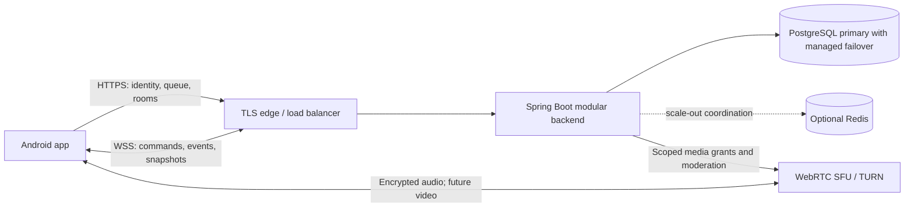

> Database decision updated: PostgreSQL supersedes the original MongoDB design. Runtime implementation remains the foundation described in README.md; the domain tables below are planned, not yet implemented.

# Ludo Binge online backend plan

Date: 9 October 2026  
Status: proposed implementation plan; no backend or online gameplay is implemented by this document.

## 1. Product scope and recommended decisions

Build a Java/Spring Boot backend with PostgreSQL as the persistent database. Keep the current native Android/Kotlin/Compose app. Online matches use an authoritative server: phones request actions and render accepted results; the server decides dice outcomes, legal moves, captures, turns and winners.

The first complete online release includes:

- Google sign-in required only when entering online play. Offline, local and Wi-Fi modes remain usable without an online account.
- Public matchmaking for exactly 2, 3, 4, 5 or 6 human players, selected before searching.
- Private rooms with shareable links, a fallback room code, host approval, live roster and readiness.
- Google profile photo and display name in online lobbies, game seats, reaction bubbles and results; no custom online avatar picker.
- Live dice, pawn moves, captures, chance indicators, turn deadlines and final results synchronized across all players.
- Optional voice chat, predefined quick messages and floating emoji broadcasts scoped to the current room.
- Reconnect/resume, app restart recovery, bounded turn waiting, abuse controls, operational monitoring and recovery from server failures.
- A media architecture that can add opt-in video in place of avatars later.

“Gmail login” is interpreted as Sign in with Google, including Google accounts whose address is not `@gmail.com`. No Gmail inbox permission is needed. Restricting to Gmail addresses is an optional product policy, not required for authentication.

### Player-count and board mapping

| Requested total players | Initial online board | Matching behavior |
| --- | --- | --- |
| 2 | Classic four-corner board | Exactly two consenting queued players |
| 3 | Classic four-corner board | Exactly three |
| 4 | Classic four-corner board | Exactly four |
| 5 | Six-seat hex board | Exactly five; unused seat remains empty |
| 6 | Six-seat hex board | Exactly six |

Counts include the private-room host. Never put five or six players on the classic board. Initially avoid additional 2–4-player hex queues because they fragment the available population; add them later if demand supports it. Validate five-seat hex geometry and rules explicitly before release.

Default decisions in this plan are proposals that allow implementation to proceed. Timing, capacity and retention values are configurable and must be tuned with device and load testing. There are no cash stakes, wallets or prizes in this scope.

## 2. Current repository and integration boundaries

Relevant code inspected:

| Existing area | Reuse or required change |
| --- | --- |
| `engine/LudoEngine.kt`, `engine/HexLudoEngine.kt`, `engine/LudoModels.kt` | Specification inputs for a pure Java server engine; verify exact rule parity |
| `ui/game/GameViewModel.kt` | Local dice generation and animation orchestration must not determine online outcomes |
| `ui/game/GameScreen.kt`, board renderers and `PlayerAvatarFrame.kt` | Reuse visuals; add online state adapter and remote photo/media rendering |
| `wifi/domain/RoomModels.kt` | Reuse UX concepts; contains emoji IDs and five predefined messages |
| `wifi/session/WifiSessionManager.kt`, `wifi/game/WifiGameCoordinator.kt` | Reference for approval, revisions, readiness and reconnect UX; do not expose LAN protocol as the internet backend |
| `wifi/voice/RoomVoiceController.kt` | Current source uses host-relayed UDP audio; online voice requires a separate internet-capable implementation |
| `ui/wifi/WifiReactionsOverlay.kt`, `WifiVoiceChatPill.kt` | Extract reusable presentation components where practical |
| `launch/HexagonLaunch.kt` | Hex mode is currently marked available; online capability still requires end-to-end validation |

Some Wi-Fi documentation describes an older WebRTC design, while current voice source uses UDP. Treat source behavior as the integration baseline and do not assume the old documented media implementation can be reused unchanged.

Add explicit online public/private session types. Account identity, seat index, board position and player color are distinct identifiers. A board rotated for the local player must not change server seat IDs or pawn coordinates.

## 3. Architecture



Use a modular monolith initially. Keep identity, matchmaking, rooms, game rules, realtime transport, social interactions, media authorization and operations as clear modules within one deployable backend. Splitting into microservices at launch would add failure modes without proving a need.

### Technology choices

| Concern | Decision |
| --- | --- |
| Runtime | Java 21 LTS baseline; current supported Spring Boot release compatible with chosen libraries |
| Build | Maven wrapper, pinned dependency versions and dependency scanning |
| API | Spring MVC, validation, JSON DTOs and OpenAPI |
| Security | Spring Security; Google ID-token verification; application access/refresh sessions |
| Realtime | Native Spring WebSocket with versioned JSON messages over WSS |
| Database | Spring JDBC / JdbcClient, HikariCP pooling, PostgreSQL transactions and Flyway migrations |
| Voice | WebRTC through an SFU with TURN; LiveKit is the proposed provider/runtime |
| Observability | Actuator, Micrometer, structured logs and distributed tracing |
| Tests | JUnit, Java/Kotlin rule fixtures, isolated PostgreSQL integration tests, protocol/device/load tests |

Java 21 is a chosen baseline, not Spring Boot's minimum. Confirm and pin a supported Boot patch at implementation time using the [official requirements](https://docs.spring.io/spring-boot/system-requirements.html).

Spring Boot handles game logic and media permissions. It does not stream audio through PostgreSQL or game WebSockets. PostgreSQL is the source of truth for committed gameplay. Redis is optional initially and, if added, holds disposable presence, routing and queue acceleration rather than replacing PostgreSQL. No Kafka requirement at launch.

For a closed beta, one backend instance is acceptable with durable recovery, but it has a reconnect window on failure. Public high availability requires at least two instances and the fenced room-owner routing described below. Two instances alone do not make in-memory state highly available.

## 4. Google identity, sessions and avatar handling

### Login flow

1. User selects Online Arena. If signed out, show Google sign-in with a clear explanation that their name/photo will be visible to other players.
2. Android Credential Manager requests a Google ID token for the configured backend OAuth client ID. Preserve any pending invite while signing in.
3. Android posts the ID token and a server-issued one-time challenge/nonce to `POST /api/v1/auth/google` over HTTPS.
4. Backend validates Google's signature, issuer, intended audience, expiry and nonce; atomically consumes the challenge. Reject expired, replayed or incorrectly targeted tokens.
5. Identify the account using Google's stable `sub` claim, not its email. Upsert the user and trusted profile fields.
6. Issue an application access token and rotating refresh token. Suggested defaults: access 15 minutes, refresh maximum 30 days, media grants 2 minutes. Values are separately configurable.
7. Android opens an authenticated WSS connection and resumes the requested flow.

Follow [Android Credential Manager guidance](https://developer.android.com/identity/sign-in/credential-manager-siwg-implementation) and [Google backend token verification](https://developers.google.com/identity/sign-in/android/backend-auth). Register development and release signing identities correctly. Client-provided name, email or photo alone is never proof of identity.

Store only hashes of refresh tokens; rotate atomically and revoke the token family if a consumed token is reused. The Android client serializes refresh attempts. Store secrets using Android Keystore-backed storage. Logout/revocation must invalidate online sessions and media access, not just delete a token on one phone. Allow browsing on multiple devices but only one controlling connection per user; an explicit takeover increments a durable connection generation and fences the old connection.

### Public profile

Public DTO: `userId`, `displayName`, `avatarUrl`, `avatarVersion`. Email, Google subject, device details, session secrets and network addresses never appear in room broadcasts.

- Use the photo from verified Google identity data. Refresh on subsequent login/profile sync; name and photo can change or be absent.
- Show a neutral initials silhouette if the photo is unavailable. This is a fallback, not a custom avatar selection.
- Display a snapshot of the public profile during a match to avoid disruptive changes mid-game.
- Image loading needs caching, bounded size, HTTPS and failure fallback. If proxying photos later, restrict upstream hosts, redirects and response size to prevent server-side request forgery.
- Put the trusted profile beside reactions and quick messages; never trust a sender photo or name supplied in a reaction command.
- “Sharing the avatar” means displaying it to participants and alongside interactions. Standalone photo sharing/download is outside this release.

## 5. Public matchmaking

Being online is not consent to play. Match only users who explicitly enter the queue, are compatible, and have a live connection. Do not expose a global directory of online users.

### Queue flow

1. Player selects 2–6 players and taps Find match.
2. Backend creates one queue ticket, with a unique active-user allocation so the player cannot also join another queue/private seat.
3. Partition candidates by board, exact player count, ruleset version, protocol compatibility and region/latency budget. Start with a single measured region suitable for the launch audience.
4. Prefer the oldest compatible tickets. Optional skill matching is deferred until there are enough players and a rating design.
5. A worker transactionally reserves all required users and creates a short-lived match proposal. Concurrent workers cannot reserve the same user.
6. Broadcast `MATCH_FOUND`; each player accepts within 15 seconds. No host approval exists for public games.
7. All accept: create the room/match idempotently and enter readiness/countdown. A decline or timeout releases the reservation; return accepting players to search with their original priority.
8. A queue cancel races safely with reservation/acceptance: the transaction decides one outcome and the client receives its final ticket state.

Queue lifecycle: `SEARCHING -> RESERVED -> ACCEPTED -> MATCHED`, with terminal `CANCELLED`/`EXPIRED`. A failed proposal returns eligible users to `SEARCHING` through a new reservation generation.

Heartbeat queue tickets while connected. Check expiry in business logic; a cleanup worker releases stale allocations. Show elapsed wait and cancel. After approximately 30–60 seconds offer a different player count or wider latency region, requiring user choice. Never silently change six-player search into two players or add bots. Exact player counts inherently increase waiting time when population is low; “online right now” does not guarantee a full match.

Blocks exclude known blocked pairs from public matches. Do not split queues by voice preference initially; voice is optional for each participant.

## 6. Private rooms, invitations and host approval

### Room lifecycle

`LOBBY -> READY_CHECK -> COUNTDOWN -> PLAYING -> FINISHED -> CLOSED`

Optional `PREPARING_ADS` and `AD_BREAK` phases must be explicitly enabled later as described in section 14. Participant reconnect status and server recovery are separate from the normal room lifecycle. Store room revision and immutable match configuration once countdown begins.

### Create and join

1. Host selects total capacity 2–6; backend derives the board, validates capability, creates the room and seats the host.
2. Return a share link such as `https://<owned-domain>/r/<random-invite-token>` and a readable room code. The actual domain must be provisioned before launch.
3. Invite token has at least 128 random bits, is stored hashed, expires (default 24 hours or room closure), and can be rotated by the host. The short code is lookup convenience with strict attempt limits, not an authentication credential.
4. Installed app opens via verified Android App Links; otherwise show a minimal landing page with install/open instructions and a copyable code. Normal App Links do not guarantee deferred restoration after installation; preserve the code manually or add an explicitly selected deferred-link solution later.
5. After Google login, invitee submits a join request. Possession of a link does not grant a seat or voice access.
6. Host sees the verified display name/photo and Accept/Decline controls. Other guests cannot see the pending applicant list.
7. Acceptance atomically checks host role, request expiry, room state, capacity, blocks and the user's active allocation. Assign exactly one free seat and broadcast the new roster.
8. Accepted users tap Ready. Host may start only when the configured capacity is filled and every player is ready/connected. To start with fewer players, host changes capacity in the lobby, everyone is informed, and readiness resets.

Join request lifecycle: `PENDING -> ACCEPTED | DECLINED | CANCELLED | EXPIRED`. Default expiry: 60 seconds; repeated submissions reuse the pending request. Full rooms and expired links produce clear recoverable errors. Cap pending requests and rate-limit applicants/room owners. Invite links expose no access token or email; landing pages must avoid leaking invite URLs to third-party analytics/referrers.

### Host limits

- Host can approve/decline requests, rotate links, remove lobby members, change lobby configuration and close the lobby.
- Host cannot choose dice, override moves, kick an active opponent to manufacture a win, force microphones on or skip another player's readiness.
- Host disconnect: reserve the role for 60 seconds, then transfer lobby control to the earliest connected admitted participant; close after a bounded empty-room timeout. An explicit host leave transfers immediately where possible.
- In a running match, the server continues independently of the host phone. Reconnection and forfeiture rules apply equally to everyone.
- No spectators, late joins or replacement players in a running match at launch.
- Rematch creates a new match ID after fresh consent/readiness; decline returns users to the lobby or home without trapping them.

## 7. Authoritative Java game engine

Create a framework-independent Java module with immutable state and a reducer such as:

```java
Transition apply(GameState state, GameCommand command, RuleContext context);
```

The context supplies server time, a controlled dice outcome source and pinned ruleset configuration. No Android classes, HTTP, databases, audio or UI animation code belongs in this module. Persist the outcome of randomness, never rely on a new random call during replay.

### Porting and rule parity

Extract rules from both existing Kotlin engines and ViewModel sequencing. Document and test yard exit, safe cells, stacking/blocking if supported, captures, capture-before-home behavior, extra laps, exact home entry, six bonuses, consecutive-six handling, capture/home bonuses, no-legal-move behavior, winner order and five/six-seat mapping. Do not substitute generic Ludo rules for the app's actual rules.

Use shared JSON state/command/result fixtures against Kotlin and Java, including existing capture/home and hex-seat test cases. Pin `rulesetVersion` and board topology for every match; a deployment never changes rules underneath an active match.

### Roll and move

1. Validate authenticated seat ownership, active connection generation, match/turn IDs, expected revision, turn phase, deadline and command schema.
2. For `ROLL_DICE`, generate an unbiased value with `SecureRandom.nextInt(6) + 1` on the server. Compute legal moves and the next phase.
3. Atomically persist the resulting state, event and command receipt. Only after commit acknowledge and broadcast the result.
4. The client animates the supplied value; it never rolls a local value for online play.
5. For `MOVE_PAWN`, verify the pawn is legal and derive movement path, capture, home and turn transitions on the server.
6. Broadcast logical transitions plus animation hints. Clients animate locally and converge on the authoritative final snapshot.

Use phases such as `WAITING_ROLL`, `WAITING_MOVE`, `RESOLVING`, `FINISHED`. Presentation timings are hints or bounded server deadlines; no opponent can freeze the match by withholding an animation acknowledgment. Handle animation skipping on slow devices without changing legal outcomes.

Proposed end condition: first player to bring all their pawns home wins and the match ends, unless the existing rule audit establishes a different intended mode. Do not fabricate second–sixth rankings from pawn distance. A future full-ranking mode needs a distinct ruleset.

### Turn timeout and abandonment defaults

- Roll decision: 15 seconds. Pawn decision after the roll: 20 seconds. Server controls deadlines; local countdown is display only.
- On expiry, execute a documented deterministic timeout action: auto-roll if needed, then choose the lowest legal pawn ID; pass if none. Record it as a system action, not a human move or undisclosed bot.
- After three consecutive turns with no human input, mark the player forfeited. Reconnect alone does not reset the missed-turn counter; valid human action does.
- Explicit leave forfeits immediately after an Android confirmation.
- Forfeited pawns are removed from active play and cannot block/capture; remaining players continue. This is an online ruleset decision to test against both boards.
- A disconnected seat is reserved for 90 seconds. Expiry forfeits it even if fewer than three turns have passed; whichever condition occurs first applies.
- If one eligible player remains, award a win by forfeit. If none remain, abandon the match without awarding a win.

These defaults prevent indefinite waiting. A future private-room “relaxed” ruleset may offer longer timers, but settings are agreed before starting and cannot be changed mid-game.

## 8. WebSocket contract and delivery semantics

Use HTTPS for lifecycle resources and one authenticated WSS connection per controlling session for realtime subscriptions/commands. Android can authenticate the upgrade with a bearer header. Never put durable credentials into query strings. If a web client is added, use a short-lived single-use socket ticket. Reject unauthorized subscriptions and recheck membership/role on every command; handshake authentication alone is insufficient.

Spring's WebSocket support supplies transport primitives; application code must implement these protocol guarantees. Follow the [Spring WebSocket reference](https://docs.spring.io/spring-framework/reference/web/websocket/server.html).

```json
{
  "protocolVersion": 1,
  "type": "MOVE_PAWN",
  "commandId": "client-generated-uuid",
  "roomId": "room-id",
  "matchId": "match-id",
  "turnId": 17,
  "connectionGeneration": 3,
  "expectedGameRevision": 42,
  "payload": { "pawnId": 2 }
}
```

```json
{
  "protocolVersion": 1,
  "type": "GAME_TRANSITION",
  "eventId": "server-generated-uuid",
  "eventSeq": 43,
  "gameRevision": 43,
  "roomId": "room-id",
  "matchId": "match-id",
  "serverTimeMs": 1791540000000,
  "causedByCommandId": "client-generated-uuid",
  "payload": { "events": ["PAWN_MOVED"], "snapshot": {}, "animation": {} }
}
```

The snapshot and animation objects above are placeholders for schema-defined full state/path DTOs. Do not implement an empty snapshot. Server derives sender identity from the session, never from an arbitrary message field.

| Channel | Commands / events |
| --- | --- |
| Connection | `PING`, `PONG`, `SESSION_REPLACED`, `REAUTH_REQUIRED`, `RESUME` |
| Matchmaking | `QUEUE_UPDATED`, `MATCH_FOUND`, `MATCH_CANCELLED` |
| Lobby | `ROOM_SNAPSHOT`, `JOIN_REQUESTED`, `JOIN_DECIDED`, `READY_CHANGED`, `COUNTDOWN_STARTED` |
| Game | `ROLL_DICE`, `MOVE_PAWN`, `GAME_TRANSITION`, `GAME_SNAPSHOT`, `MATCH_FINISHED` |
| Social | `SEND_REACTION`, `SEND_QUICK_MESSAGE`, `REACTION_ACCEPTED`, `QUICK_MESSAGE_ACCEPTED` |
| Recovery | `COMMAND_ACK`, `COMMAND_REJECTED`, `RESYNC_REQUIRED`, `SERVER_RECOVERING` |

Use independent room and game revisions so an emoji/presence update does not invalidate a legal move. Assign one sequential durable game event per committed game revision, with multiple logical effects in its payload. Ephemeral social events have event IDs and expiry but are excluded from durable gameplay sequencing.

Delivery is at-least-once with idempotent effects, not an exactly-once network promise. A unique `(matchId, userId, commandId)` receipt records the request hash and result. Same ID/same body returns the prior result; same ID/different body is rejected. Look up a receipt before rejecting an old expected revision. A retry after an unknown commit outcome must resolve that receipt before generating another dice result.

Clients deduplicate durable events by sequence, detect gaps, buffer a bounded number and request resync. Start with complete snapshots after actions because six-player Ludo state is small; optimize deltas only after measuring. Ordered socket writes, bounded frame sizes (initially 64 KiB), bounded queues and priority for gameplay over reactions are mandatory. Disconnect/resync a slow consumer instead of growing memory indefinitely.

Errors contain a stable code, related command ID, retryability and current revision where useful: `NOT_YOUR_TURN`, `STALE_REVISION`, `ILLEGAL_MOVE`, `ROOM_FULL`, `REQUEST_EXPIRED`, `SESSION_REPLACED`, `RATE_LIMITED`, `SERVICE_RECOVERING`. Never expose stack traces.

## 9. Durable consistency, ownership and recovery

### Commit algorithm

Serialize commands per match through a bounded mailbox. In a PostgreSQL transaction:

1. Verify the active room-owner epoch/lease and expected state revision.
2. Check/insert the idempotency receipt and validate the command.
3. Update the current match snapshot with compare-and-set revision.
4. Insert the durable game event and transactional outbox record.
5. Store the accepted receipt/result and commit durably; choose synchronous replication to meet the stated production RPO.

Publish only committed events. If broadcasting fails after commit, the outbox retries; clients deduplicate. If the database becomes unavailable, stop accepting authoritative actions and show recovery rather than progressing only in memory. Keep social/media failures independent from game commits.

Development uses a single PostgreSQL instance. Production uses managed PostgreSQL HA with tested failover and durability settings matched to its RPO. Transactions also protect multi-user queue reservation, seat assignment and allocation release. Do not use in-memory locks alone across replicas.

### Scale-out ownership

Assign one active logical owner to each room. Store `ownerInstanceId`, monotonically increasing `ownerEpoch` and `leaseUntil` in an ownership row. Acquisition increments the epoch atomically. Each authoritative transaction conditionally writes that ownership row with the matching epoch and valid lease, creating a write conflict with takeover; reading it without a fenced write is insufficient.

Use bounded clock skew and database-coordinated lease comparisons. Lease renewal and takeover are explicit tested code paths. A stalled old owner cannot commit with its stale epoch. Conditional match revision updates provide an additional conflict check.

Connections may land on any gateway. Route commands through authenticated internal RPC to the owner. Workers claim committed outbox rows with SELECT FOR UPDATE SKIP LOCKED and publish to gateways or an optional Redis delivery layer. Persist delivery attempts and acknowledgements; support snapshot fallback if retained history expires. Redis Pub/Sub alone is not a durable event log. Sticky sessions can reduce routing work but must never be a correctness requirement.

### Client reconnect

- Initial heartbeat: every 10 seconds; consider a link suspect after roughly 30 seconds without traffic. Load-balancer idle timeout must exceed heartbeat cadence.
- Retry with jittered exponential backoff, starting around 0.5 seconds and capped at 15 seconds. React to Android network changes without spawning duplicate loops.
- Show separate Game reconnecting and Voice reconnecting states. Disable stale move controls while game transport is disconnected.
- Reauthenticate and send match ID plus last applied event sequence. Server returns retained events or a complete snapshot and authoritative deadlines.
- Synchronize snapshot and live subscription against a sequence watermark to avoid missing events between them.
- Resume the same account/seat and connection generation. A link, display name or room code cannot reclaim another user's seat.
- Retry uncertain commands with the original command ID. Never queue a new roll or several stale pawn actions while offline.
- On process restart, recover the user's active match through `/me/active-session`; token refresh and snapshot restore occur before controls enable.

Persist deadlines and outstanding dice state. On server failover, reconstruct from the last committed snapshot/events. Apply a bounded recovery grace (for example 15 seconds) as a committed event before resuming timers; do not mass-forfeit players for backend downtime. If the outage exceeds the supported recovery window, terminate as interrupted/no contest, never invent a result. Target recovery under 15 seconds in ordinary failover; measure it rather than promising uninterrupted connectivity.

## 10. PostgreSQL table design

Use timestamptz for dates/expiry, UUID primary keys, foreign keys, CHECK constraints and explicit unique indexes. Separate unbounded history tables from current-state rows. Use JSONB only for versioned game snapshots and event payloads; keep identities, allocations, seats and searchable lifecycle fields relational.

| Table | Important fields | Indexes / lifecycle |
| --- | --- | --- |
| `users` | Google subject, private email, name, photo, status, created/last-login | Unique `googleSub`; no public email lookup |
| `auth_challenges` | nonce hash, expiry, consumed status | Unique nonce hash; indexed expiry cleanup |
| `refresh_sessions` | user, token-family/hash, device, expiry, revoked/consumed | Unique token hash; user/family lookup; indexed expiry cleanup |
| `user_allocations` | user, queue/room/match reference, generation, state | `PRIMARY KEY (user_id)` enforces one active allocation |
| `queue_tickets` | count, board, region, ruleset, status, reservation, expiry | Compound partition/status/created index; expiry cleanup |
| `rooms` | host, capacity, board, phase, revision, bounded seats, config | Phase/updated index; bounded max six seats |
| `room_ownership` | room, owner, epoch, lease expiry | `PRIMARY KEY (room_id)`; lease lookup |
| `room_invites` | room, token hash, normalized code, expiry, revoked | Unique token hash; unique code; indexed expiry cleanup |
| `join_requests` | room, applicant, status, expiry | Partial unique room/applicant for `PENDING`; host lookup |
| `matches` | room, ruleset, players, state, revision, deadlines, outcome | Status/updated and participants/start indexes |
| `match_events` | match, sequence, command reference, effects, timestamp | Unique `(matchId,eventSeq)`; finite retention |
| `command_receipts` | scope/match, user, command ID, body hash, response | Unique scope/user/command; retained through recovery window |
| `outbox` | event ID, destination, payload/ref, attempts, delivery state | Unique event ID; pending/next-attempt index |
| `player_stats` | user, completed matches, wins, forfeits | Unique user; updated idempotently by result event |
| `result_applications` | result event/user and applied marker | Unique event/user to prevent double stats |
| `blocks` | blocker, blocked user | Unique pair |
| `reports` | reporter, reported user, match, reason, status | Moderation status/created and match lookup |

Store Google ID tokens only long enough to validate; do not save them as user documents. Never store live audio/video or every heartbeat in match history.

PostgreSQL has no automatic TTL deletion. A scheduled worker cleans expired rows in bounded indexed batches. Every expiry-sensitive authorization still checks expiresAt; cleanup must not delete an allocation that owns a seat. Release allocations with validated state transitions and a reconciliation worker.

Proposed retention: replay/command receipts 30 days after match end, summarized match history 90 days, delivered outbox payloads 7 days, pending join requests one day after resolution. Active matches and undelivered outbox records never expire by these cleanup rules. Make report retention and account deletion behavior explicit before release. Use backup retention and tested restore procedures; production standby redundancy alone is not a backup.

## 11. Voice chat and future video

### Voice in the first online release

Use WebRTC with an SFU and TURN fallback. LiveKit is the proposed choice because the same media integration can support voice now and video later; confirm its operational cost before choosing managed versus self-hosted deployment. The [SFU architecture](https://docs.livekit.io/reference/internals/livekit-sfu/) avoids each six-player phone uploading separate copies to five peers.

1. Admitted player explicitly chooses Join voice; microphone starts off.
2. Backend validates membership and issues a short-lived grant restricted to the current media room and user identity, with audio publish/subscribe only.
3. Android connects through the media SDK; audio never travels over the gameplay socket.
4. User can enable mic after permission, mute another player locally, change volume/output and leave voice.
5. Speaking indicators come from media track activity and are visually distinct from the active-turn indicator.
6. Leave/kick/ban removes media access as well as game membership. Pending applicants cannot subscribe or obtain grants.

TURN is required for difficult NAT/firewall/mobile networks; test UDP, relay and TCP/TLS fallback. Self-hosting requires exposed media ports, a proper public address and a TURN deployment, not only an HTTPS reverse proxy. SDK reconnection support helps but must be tested across Wi-Fi/mobile transitions: [LiveKit connection behavior](https://docs.livekit.io/intro/basics/connect/).

Stop capture on mic-off, backgrounding, phone-call interruption, logout and any ad overlay. Permission denial never prevents gameplay. Do not restart capture automatically after an interruption. Handle Bluetooth/wired routing, audio focus, echo cancellation and game-sound ducking. Maintain game connectivity independently if media is degraded or unavailable.

Validate provider webhook signatures and deduplicate webhook IDs. Do not use a media webhook as proof that a game command is legal. Grant expiry alone does not necessarily evict an already connected participant. Apply explicit removal/permission changes and verify rejoin revocation for the selected deployment. LiveKit Cloud and self-hosted revocation behavior differ; short tokens alone leave a replay window. Strict removal must be a launch acceptance test. See [participant management](https://docs.livekit.io/intro/basics/rooms-participants-tracks/participants/) and [token grants](https://docs.livekit.io/frontends/reference/tokens-grants/).

Transport encryption is mandatory. Do not claim end-to-end encryption merely because WebRTC encrypts transport to an SFU. No voice recording by default; report tools can collect match/user metadata without recording speech.

### Future video instead of avatars

- Use the same room/user media identities and SDK, adding camera publishing permissions only when the feature is enabled.
- Add a seat presentation model: `AVATAR`, `VIDEO_CONNECTING`, `VIDEO_ACTIVE`, `VIDEO_UNAVAILABLE`.
- Camera is explicit opt-in, starts off, and stops on backgrounding/interruption. No host can enable another player's camera.
- Render cropped video inside the existing avatar frame; Google photo is the immediate fallback when disabled, disconnected or bandwidth constrained.
- Keep a verified name/identity label alongside the video. No new game-state authority is introduced.
- Add adaptive subscriptions, simulcast where supported, small-tile resolution/frame-rate caps and audio-priority degradation. Subscribe only to visible tracks.
- Gate rollout on six-device bandwidth, thermal, battery, moderation and cost tests. Video abuse/reporting and consent design are separate release requirements.

Media egress grows with participants and subscribed tracks. Estimate cost from participant-minutes and measured delivered bitrates; do not assume free-tier limits or quote unverified prices.

## 12. Quick messages, emoji and game-screen UX

Reuse the existing message IDs for “Well played!”, “Nice move!”, “Good luck!”, “Hurry up!” and “Oops!”. Server accepts an allowlisted message ID, not arbitrary text. Clients localize it using a versioned catalog. Start with the existing familiar emoji catalog and expose a bounded tray; keep catalogs compatible with older clients.

For both event types, server validates membership, phase, block/mute policy and rate limit, then broadcasts an event containing trusted sender ID, profile reference, event ID and expiry. Initial combined limit: burst 3, refill 1 token per 2 seconds, plus a room-wide cap. Tune separately from gameplay limits.

- All current room members, including the sender, render the accepted event once.
- Reactions float across the screen like Wi-Fi Arena, show the sender photo/name, expire after about 3 seconds and never intercept board touches.
- Quick messages appear as brief bubbles tied to the sender, with a short bounded recent-message strip if space permits.
- Drop old reactions on reconnect; do not replay a flood of stale emoji. Use local hide/mute and reduced-motion alternatives.
- Maximum four active overlays; bounded queue; social traffic cannot delay dice/move messages.
- Restrict broadcasts to admitted members of the same room. “Broadcast” does not mean globally to all online users.

Game screen also needs connection quality, reconnect countdown, turn countdown, leave confirmation, voice status, per-player mute/report/block actions and an authoritative result screen. Keep the existing board geometry and touch targets. Show network latency as a rough quality signal, not proof of a player's device or honesty.

## 13. REST API outline

All resources use `/api/v1`. Authenticate except public health, auth challenge/login and minimal invitation landing data. Mutating lifecycle requests use idempotency keys with request hashes. Check roles and membership server-side.

| Method / path | Purpose |
| --- | --- |
| `POST /auth/challenge`, `POST /auth/google` | One-time challenge and Google token exchange |
| `POST /auth/refresh`, `POST /auth/logout` | Rotation and revocation |
| `GET /me`, `GET /me/active-session` | Profile and restart recovery |
| `DELETE /me` | Account deletion workflow and active-session cleanup |
| `GET /config` | Supported rulesets, counts, catalog and minimum protocol |
| `POST /matchmaking/tickets` | Enter selected queue |
| `GET /matchmaking/tickets/{id}` | Reconcile state after reconnect |
| `DELETE /matchmaking/tickets/{id}` | Cancel queue ticket |
| `POST /matchmaking/proposals/{id}/accept` | Accept reserved match |
| `POST /matchmaking/proposals/{id}/decline` | Decline proposal |
| `POST /rooms`, `GET /rooms/{id}` | Create/get authorized room |
| `POST /rooms/{id}/invites` | Create/rotate invitation |
| `POST /invites/resolve` | Resolve token/code with minimal disclosure |
| `POST /rooms/{id}/join-requests` | Request admission |
| `POST /rooms/{id}/join-requests/{requestId}/decision` | Host accepts/declines |
| `PATCH /rooms/{id}/configuration` | Host updates lobby and resets readiness |
| `POST /rooms/{id}/ready`, `POST /rooms/{id}/start` | Readiness and validated start |
| `POST /rooms/{id}/leave`, `DELETE /rooms/{id}/members/{userId}` | Leave or lobby-only removal |
| `POST /rooms/{id}/rematch` | Request/consent to new match |
| `GET /matches/{id}`, `GET /matches/{id}/events?afterSeq=…` | Member-authorized snapshot/recovery |
| `POST /rooms/{id}/media-token` | Scoped media permission |
| `POST /reports`, `POST /blocks`, `DELETE /blocks/{userId}` | Abuse controls |
| `GET /me/matches` | Paginated own results |

Room changes use expected room revision. Dice and moves use WSS commands, not competing independent REST mutations. Both REST and WSS route through the same application services/owner for shared state. HTTP statuses distinguish unauthorized, forbidden, conflict, validation and rate-limit errors.

## 14. Advertising and background behavior

Wi-Fi Arena currently contains pregame rewarded ads and shared periodic breaks. Do not automatically inherit those into online play: unbounded ad waits can stall remote strangers.

Recommended initial online policy: ads on home/results surfaces; no forced mid-match ad pause. If online rewarded gating is required, implement it as a separate feature with server-owned ad cycle IDs, finite readiness deadlines, failure/cancel policy, communication suspension and provider verification where available. A client callback is not tamper-proof proof of watching an ad.

Never show an individual interstitial while that player's live turn clock continues unseen. Never open the mic during an ad. A periodic shared ad break, if later approved, needs a persisted safe boundary and a bounded recovery/forfeit policy for unavailable ad services. Do not copy indefinite “wait for everyone” behavior into public matchmaking.

Android backgrounding does not guarantee sockets stay alive. Preserve resume metadata, turn mic/camera off and rely on server deadlines/reconnect. Notifications for invites or turn reminders are optional later; notification delivery is never the source of game truth.

## 15. Security and operational controls

- Enforce TLS/WSS, JWT issuer/audience/expiry and per-command authorization. Handle access-token expiry on live sockets with explicit reauthentication and bounded grace.
- Native clients may omit Origin; authenticate them. Any browser-facing socket must use an explicit origin allowlist. CORS alone does not secure WebSockets.
- Use request schemas, numeric bounds, payload limits, bounded collections and unknown-enum handling. Never deserialize user-controlled Java types.
- Rate-limit login, invite/code resolution, joins, queue churn and reactions. Separate game-command budgets so social spam cannot consume them.
- Protect secrets using the deployment secret store; no Google secrets, signing keys or media API secrets in the APK/repository.
- Restrict database network access and roles; keep operational/admin APIs private and audit moderation actions.
- Redact Google tokens, refresh tokens, invite tokens and private emails from logs. Use correlation IDs for diagnosis.
- Add mute, block and report from the game screen. Define moderation ownership and a suspension/appeal process before public voice launch.
- Account deletion revokes sessions/media, releases queue/lobby state and applies a documented active-match forfeit policy; delete/anonymize profile references subject to necessary retained records.
- Treat collusion and automation as separate from move validation. Server authority prevents forged moves, not all cheating. Device attestation/risk scoring and ranked play can follow later; do not claim bots are impossible.

## 16. Deployment, reliability and measurable targets

### Environments

Local: Docker Compose with backend and a PostgreSQL primary with managed failover; optional local media stack. Staging: realistic TLS/App Links, Google test identities, media provider and at least two backend instances for failover tests. Production: managed PostgreSQL HA/backups, health-checked edge, secrets, monitored media service and a rollback process.

Start in one region near the initial audience; measure India-region latency if India is the target. Cross-region games need latency policy. Active-active multi-region game writes are deferred; a match belongs to one region.

Deployments drain queue intake/room ownership before shutdown, transfer or resume rooms under fencing, and keep protocol/ruleset compatibility. Use expand/contract schema changes and feature flags for player counts, public matching, voice and later video. Health probes distinguish a live JVM from readiness to accept games. Protect Actuator endpoints.

### Initial targets, not measured promises

| Metric | Proposed acceptance target |
| --- | --- |
| Durable game command processing | p95 under 150 ms excluding network under agreed load |
| Player action to remote UI event | p95 under 500 ms on healthy same-region mobile links |
| Reconnect after restored network | p95 under 5 seconds under ordinary conditions |
| Backend room recovery | under 15 seconds for a single-node failure |
| Voice mouth-to-ear latency | p95 under 300 ms on healthy test networks |
| Accepted-action loss | zero acknowledged committed actions lost within tested synchronous-replication failure model |
| Initial availability objective | 99.9% monthly for online admission/game service; measured separately from media |

Set load-test launch target initially at 1,000 concurrent players, then revise from actual budget. With average four players this is about 250 matches and 1,000 sockets; voice is a separate capacity test. Derive peak commands/second from turn duration and bursts, not only user count. Ramp tests and soak for several hours while measuring heap, socket queues, database latency, outbox lag and media egress.

Dashboards: queue wait by count, match acceptance/cancel rate, active matches, abnormal disconnects, reconnect success, ownership conflicts, action latency, rejection reasons, turn timeouts, PostgreSQL replication health, outbox backlog, voice join success and relay percentage. Alert on sustained error/latency changes and stuck games. Prepare runbooks for database outage, media outage, queue deadlock, compromised keys and rollback.

## 17. Test and release acceptance matrix

| Area | Required verification |
| --- | --- |
| Identity | Wrong audience/issuer, expired/replayed token, missing photo, nonce replay, refresh reuse, logout and two-device takeover |
| Matchmaking | All five counts, no duplicate allocation, exact count, cancel/reserve races, declined proposals, expired tickets and blocked pair exclusion |
| Private rooms | Host included in capacity, simultaneous accepts for final seat, expired/rotated invite, unauthorized approval, host transfer, late join denied |
| Rules | Java/Kotlin fixture parity, all capture/home/six rules, classic/hex and five-player seat mapping |
| Commands | Duplicate roll returns same value, same-ID altered body rejected, stale moves, wrong seat, old connection, simultaneous command/timeout |
| Persistence | Crash before commit, after commit before ACK, after ACK before broadcast, transaction retry, outbox duplicate, stats applied once |
| Recovery | Wi-Fi/mobile handover, airplane mode, app kill/restart, expired access token, missed sequence and snapshot/subscription race |
| Ownership | Two owners racing, expired lease, stale owner attempting writes, database election and deployment drain |
| Media | Six physical devices, TURN-only network, denied/revoked mic permission, Bluetooth, phone calls, removed-user rejoin denied and provider outage |
| Social | Sender identity spoof, cross-room leakage, spam caps, dedupe, expiry, reduced motion and no blocked board input |
| UI | Google photos on all screens, missing-image fallback, local-seat rotation, countdown synchronization and result consistency |
| Operations | Restore from backup, load/soak test, oldest supported app compatibility and rollback |

Test packet loss, high latency, duplicate application retries and reconnect storms. WSS preserves order on a connection, but reconnects and event retries still need application-level sequence handling. Emulator success does not establish multi-device audio quality or mobile network resilience.

Release is blocked if any test can produce two different authoritative boards for the same revision, duplicate accepted rolls, capacity overflow, an unapproved media listener, or a winner caused solely by a server recovery pause.

## 18. Implementation roadmap and deliverables

| Phase | Deliverables | Exit condition |
| --- | --- | --- |
| 0: contracts and rules | Rules audit, board/count matrix, state machines, JSON schemas, OpenAPI, architecture decisions | Agreed defaults and parity fixtures for both boards |
| 1: foundation | Java project, PostgreSQL with Flyway migrations, auth/profile, sessions, config, metrics and CI | Real Google login with photo; offline modes unaffected |
| 2: private lobby | Room creation, verified links/code fallback, requests, atomic seats, readiness and host transfer | Six signed-in users can form a private lobby safely |
| 3: game authority | Java engine, secure dice, durable commits/receipts/outbox, Android online adapter | Complete private games across 2–6 players with parity |
| 4: recovery | Resume, deadlines, takeover, fenced ownership, restart recovery, results/stats | Fault-injection matrix passes |
| 5: public matching | Queue/reservation/proposals, cancellation, partitioning and stale cleanup | Exact-count public matches with no double assignment |
| 6: communication | Voice SFU/TURN, Google avatars, quick messages, emoji, mute/block/report | Six-device voice and social acceptance passes |
| 7: production hardening | Load tests, dashboards, backups, runbooks, staging rollout and compatibility | Quantified capacity and staged release sign-off |
| Future: video | Opt-in camera, avatar fallback, adaptive media and moderation | Separate privacy, performance and cost acceptance |

Voice/token proof-of-concept should occur during phase 1 to expose integration risks early, while its polished game UI ships in phase 6. All phases through 7 belong to the requested complete online release; stopping after login or private rooms is not completion.

### Proposed backend layout

```text
backend/
  pom.xml
  mvnw
  src/main/java/ludo/binge/backend/
    identity/
    profile/
    matchmaking/
    room/
    game/domain/
    game/application/
    realtime/
    persistence/
    social/
    media/
    moderation/
    operations/
    shared/
  src/main/resources/
  src/test/java/
  contracts/
  deploy/
```

Android additions: `online/auth`, `online/api`, `online/protocol`, `online/session`, `online/game`, `online/media`, and `ui/online`. Introduce `OnlineSessionManager`, `OnlineGameCoordinator`, `OnlineGameStateMapper`, `OnlineMediaController`, and an online repository. Reuse presentation without forcing LAN and internet transport to share the same implementation.

Provide backend setup instructions, `.env.example` with placeholders only, indexes/migrations, API schemas, fixture data, deployment templates and runbooks alongside code. No production keys are required to write most of the implementation; real Google OAuth configuration, owned invite domain and chosen media hosting are required for end-to-end launch.

## 19. Product choices to revisit before launch

The plan uses the following defaults rather than leaving implementation undefined:

| Topic | Default |
| --- | --- |
| Google vs Gmail-only accounts | Any supported Google account |
| First winner vs full ranking | First winner ends match, subject to existing-rule audit |
| Public bots | None; documented timeout actions only |
| Private capacity | Exactly selected count; host can change it before readiness |
| Disconnection | 90-second seat grace; timers continue; bounded backend recovery pause |
| Voice | Optional, user joins, mic initially off |
| Video | Future feature; schema/UI extension points now |
| Online ads | Home/results only initially |
| Public skill rating | Deferred until population and ranking rules justify it |
| Spectators/friend lists/invite notifications | Deferred; share links cover initial friend joining |
| PostgreSQL | Persistent source of truth; Flyway migrations, transactions and managed production HA |
| Extra infrastructure | SFU/TURN required for media; Redis optional for scale |

The core reliability contract is: every accepted action has one durable authoritative result, every returning player can recover that result, and a failed voice connection or departed host cannot independently corrupt the game.

## 20. Stronger production architecture and scaling plan

This section incorporates the follow-up technology recommendations. It strengthens the deployment requirements in sections 3 and 16 without changing the authoritative game protocol or the choice of Java/Spring Boot and PostgreSQL. The single-instance option is limited to development and closed beta; public production must meet the availability and recovery gates below.

### 20.1 Production baseline

| Area | Public-production requirement | Reason |
| --- | --- | --- |
| Application | At least two Spring Boot instances distributed across availability zones, behind a health-checked load balancer | Survive an instance failure and support deployment draining |
| Match authority | One logical owner per match, durable ownership epochs, fenced writes and tested takeover | Prevent two servers from accepting conflicting actions |
| Database | Managed PostgreSQL with a cross-zone standby, tested failover and point-in-time recovery | Keep committed state available within the tested failure model |
| Recovery | Durably committed snapshots, command receipts, event history, outbox and replay | Preserve acknowledged actions and recover missed delivery |
| Backups | Automated backups, defined retention, point-in-time recovery where supported and exercised restore procedures | Recover from deletion or corruption beyond replica failover |
| Media | Managed LiveKit initially, with TURN coverage validated on target networks | Reduce media operations work and prepare for future video |
| Operations | Metrics, tracing, actionable alerts, deployment rollback and fault-injection tests | Establish that recovery works under realistic failure |
| Capacity | Measured load limits, bounded queues, admission controls and spare capacity | Avoid cascading failures during bursts or reconnect storms |

Two application instances alone do not establish zone resilience. Validate database failover, load balancer, secrets access, networking, owner takeover and capacity in the surviving zone. The remaining capacity must handle the agreed launch load after the tested failure. Application failover may still require clients to reconnect; do not promise invisible or zero-time recovery.

PostgreSQL transactions remain the basis for atomic state changes. Use READ COMMITTED with explicit row locks or conditional revision updates; retry complete transactions on serialization failures or deadlocks, with bounded backoff and idempotency.

### 20.2 Technology roles and boundaries

**Java and Spring Boot:** retain the modular backend for identity, rooms, matching and game execution. Scale instances before splitting every module into a service. Keep the pure Java engine independently testable so it can later run in dedicated workers without rewriting rules.

**PostgreSQL:** keep authoritative current match state, committed event history, user allocations and idempotency records. Optimize indexes, transaction duration and data retention before introducing database sharding. Never move accepted game state into an unreplicated memory cache for apparent speed.

**Redis:** introduce managed Redis when measured presence, rate-limit or routing traffic makes it worthwhile. Cache entries must have expiry and reconstruction paths. If Redis is unavailable, pause new matchmaking or fall back to explicitly supported database coordination; continue existing matches only where durable ownership remains valid. Avoid an uncontrolled fallback that overloads PostgreSQL.

Redis Pub/Sub is at-most-once delivery and cannot be the sole transport record for dice or moves. Keep durable outbox/history plus replay even when Redis distributes notifications. See [Redis Pub/Sub semantics](https://redis.io/docs/latest/manual/pubsub/).

**LiveKit:** scale voice/video separately from game services. Managed hosting is the initial recommendation, subject to cost and regional availability checks. If later self-hosted across nodes, LiveKit uses Redis for its own distributed coordination; this is separate from the game backend's optional Redis role. Isolate resource budgets and failure domains instead of assuming one shared Redis deployment is sufficient. See [LiveKit distributed deployment](https://docs.livekit.io/transport/self-hosting/distributed/).

### 20.3 Staged growth

These are architectural stages, not promises of a particular player capacity. Use the 1,000-concurrent-player test target in section 16 as an initial workload to measure, not a hardware sizing guarantee.

| Stage | Architecture | Evidence required to advance |
| --- | --- | --- |
| Development / closed beta | One modular backend, PostgreSQL, media integration | Functional correctness, rule parity and durable restart recovery |
| Public launch | Multiple backend instances across zones, managed database, managed media, tested owner routing | Launch load and single-instance/zone failure tests meet agreed objectives |
| Growing traffic | More backend capacity; Redis where useful; tuned indexes and limits | Sustained latency, queue or resource measurements identify the actual bottleneck |
| Independent scaling | Separate WebSocket gateways and game workers; durable internal routing and backpressure | Socket count/reconnect load and game execution need materially different capacity |
| Event ecosystem | Durable event platform for independent downstream consumers | Analytics, notifications or fraud pipelines need replay, isolation and their own throughput |
| Geographic expansion | Regional matchmaking/game clusters with explicit match home region | Measured user geography and latency justify regional cost and complexity |

At every stage, retain the same command IDs, state revisions, durable commit-before-ACK rule and reconnect semantics. Infrastructure changes must not weaken game correctness.

### 20.4 When to introduce additional technologies

| Technology / change | Adopt when | Constraints |
| --- | --- | --- |
| Separate socket gateways | Connection count, reconnect bursts or socket memory require scaling independently of rules processing | Preserve authenticated user identity, connection generations, sequence replay and owner routing |
| Dedicated game workers | Match mailboxes/processing become a distinct resource or deployment concern | One fenced owner per match; graceful draining; no dependence on a gateway remaining alive |
| Kafka or another durable event platform | Several independent consumers need retained events and independent processing/replay | Publish from the transactional outbox; consumers remain idempotent; keep analytics off the critical move path |
| Kubernetes | Deployment count, scheduling needs and operational expertise justify a cluster | Require reliable probes, disruption controls, resource limits and ownership-aware shutdown; Kubernetes does not recover game state itself |
| Regional clusters | A substantial user group misses latency targets because of geography | Assign one home region per match; define queue expansion, routing and disaster-recovery policy |
| PostgreSQL partitioning / sharding | Measured database size/write throughput exceeds a suitably tuned primary | Review shard-key distribution and cross-shard transactions before migration |
| Agones | Dedicated game-server process allocation becomes an actual requirement | It orchestrates game-server processes on Kubernetes; do not start with one process/pod per Ludo room |

Agones is a possible later hosting choice, not a required dependency for this turn-based game. See the [Agones overview](https://www.agones.dev/site/docs/overview/).

### 20.5 Scaling signals and overload behavior

Track active sockets, active matches, command queue depth/age, p95/p99 processing latency, heap/GC, database transaction latency/conflicts, connection pool saturation, outbox lag and reconnect rate. CPU alone is insufficient for scaling long-lived connections.

- Add capacity before sustained resource pressure consumes the tested failover headroom.
- Scale down only after draining new assignments and transferring/recovering owned rooms. Never terminate an owner merely because aggregate CPU is low.
- Bound admission to new queues/rooms when overloaded and return a clear retry response. Protect existing games before accepting unlimited new work.
- Rate-limit reconnect attempts with jitter and per-session limits; avoid synchronized reconnects after deployment or network restoration.
- Drop expired social events first. Never silently drop an acknowledged authoritative move.
- Measure media participant-minutes, subscribed track bitrate, relay usage and egress separately from game API traffic. Video requires a fresh capacity and cost review.

### 20.6 Reliability targets that must be finalized

Before choosing a provider/instance size or committing to a production budget, record:

| Input | Planning default / required decision |
| --- | --- |
| Peak concurrent players | Initial load-test target 1,000; confirm expected launch peak and burst factor |
| Match mix | Measure distribution of 2–6-player matches, session length and actions per minute |
| Launch geography | Start in one region near the actual audience; confirm audience location |
| Voice adoption | Test both expected participation and all-six-players voice usage |
| Monthly budget | Must include backend, database, backup, media, TURN/egress, observability and spare capacity |
| Service objective | Initial 99.9% monthly target; define measurement and included failure cases |
| Ordinary failover RTO | Target recovery under 15 seconds, verified under load |
| Ordinary failover RPO | Zero acknowledged-action loss within the tested synchronous-replication failure model |
| Regional disaster RTO/RPO | Explicitly choose and test; ordinary replica failover targets do not automatically apply |

RTO is how long recovery may take; RPO is how much committed data may be lost. A backup restoration can have different targets from a single-node failover. Do not claim multi-region zero-data-loss recovery without a replication and consistency design that supports it.

### 20.7 Additional production deliverables

Extend phase 7 with infrastructure-as-code, an environment topology diagram, capacity/cost worksheet, load-test report, zone-failure drill, backup-restore report and deployment/rollback runbook. Include tests for Redis outage if Redis is introduced, media-provider outage, gateway restart, owner crash and stale-owner writes.

Public release requires evidence that these failure drills preserve authoritative results, that the surviving capacity handles the target workload, and that alerts identify the failure. More technologies are optional; verified correctness and recovery are mandatory.
